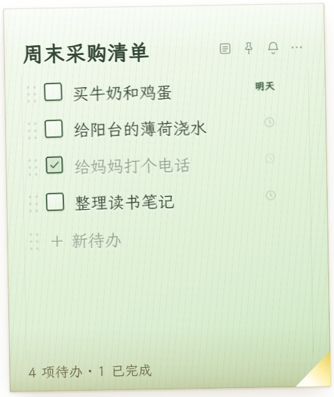
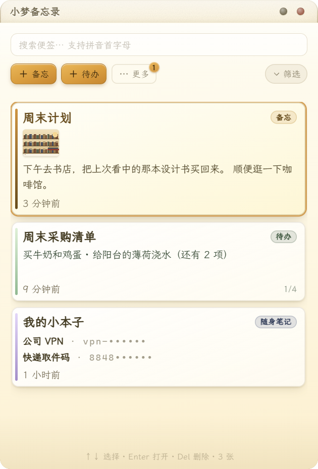
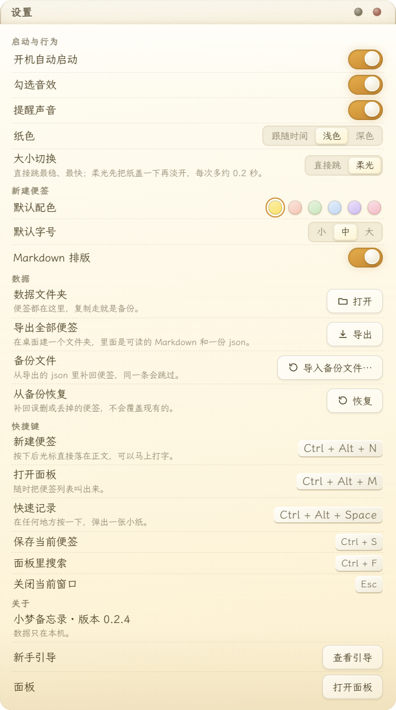
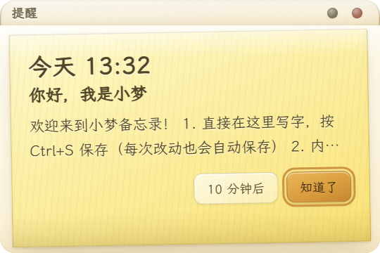
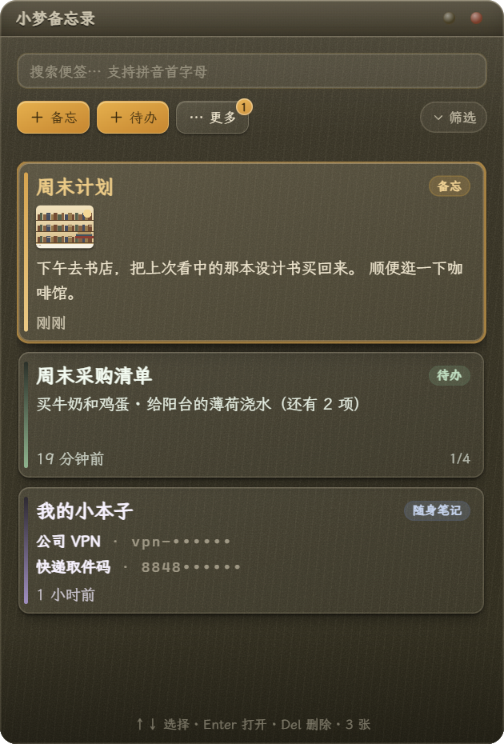

# 小梦备忘录 · 桌面便签

**开机就在、随手记、置顶看** —— 一张贴在屏幕上的便签纸。启动快、体积小、功能克制，不做笔记软件。


[](https://github.com/star620/XiaoMengMEMO/actions/workflows/ci.yml)
[](https://github.com/star620/XiaoMengMEMO/releases/latest)

## 截图

| 备忘便签 | 待办便签 |
| --- | --- |
|  |  |

| 召唤面板（搜索 / 筛选） | 设置 |
| --- | --- |
|  |  |

| 到点提醒 | 夜间纸色 |
| --- | --- |
|  |  |

> 都是程序真实运行的截图（Windows 11，150% 缩放）。纸面、折角、复选框全由 CSS / 内联 SVG 画出，不用任何图片素材。

## 为什么做它

| 痛点 | 它怎么做 |
| --- | --- |
| 启动慢、体积大 | 安装包约 3 MB，第一张便签 1 秒内出现 |
| 灵感来了记不下 | `Ctrl + Alt + N` 在鼠标位置弹便签，不打断当前窗口 |
| 被窗口盖住就忘 | 一键置顶；也能取消置顶被正常盖住 |
| 忘掉要做的事 | 待办清单 + 到点提醒，可重复 |

## 功能

**记**
- 全局快捷键新建便签（鼠标位置、不抢焦点）、`Ctrl + Alt + Space` 快速记录条、从剪贴板一键生成
- 三种便签：备忘 / 待办（勾掉划线 + 轻音效、拖动排序、截止日期）/ 随身笔记（省 Key 兑换码，默认打码、点击复制）

**看**
- 无边框透明纸窗，6 种纸色，夜间自动换深色纸（跟随时间或手动）
- 置顶 / 收起成标题条 / 锁定只读；字号与窗口尺寸各三档；拖到屏幕边自动吸附对齐
- 长文在正文里滚动，纸边随滚动淡出

**管**
- 面板多选：一键勾选多张（`Ctrl` 连选、`Shift` 连段、`Ctrl+A` 全选），批量置顶 / 改纸色 / 删除；右键单张卡片可置顶、改色、复制正文、设提醒、导出、删除
- 修改记录：每张便签留最近 60 版，可看差异、可恢复
- 回收站 30 天，删除后 5 秒内可撤销
- 轻量 Markdown（可关）、导出 Markdown + JSON、从备份导入

**找**：`Ctrl + Alt + M` 唤出面板，搜索标题 / 正文 / 待办，支持拼音首字母（打 `bg` 找「报告」），命中高亮；可按时间、类型、纸色筛选，筛选条件一键重置

**留在手边**：关掉面板只是最小化到任务栏，程序常驻后台；点任务栏按钮、托盘图标或 `Ctrl + Alt + M` 都能立刻叫回来

**提醒**：自定时间或「10 分钟后 / 明天 9:00」，支持每天 / 工作日 / 每周重复；到点弹窗，同时发系统通知 + 提示音 + 任务栏闪烁

## 下载与安装

1. 到 [Releases](https://github.com/star620/XiaoMengMEMO/releases/latest) 下载 `XiaoMengMemo_x.y.z_x64-setup.exe`（约 3 MB），双击安装。每次发布都附 SHA256，可自行校验。
2. 若 Windows 弹出「已保护你的电脑」：点「更多信息 → 仍要运行」。未签名程序首次运行都会提示，不是报错。
3. 装完从开始菜单或桌面快捷方式启动；可勾选开机自启。

系统要求：Windows 10 / 11（x64），需要 WebView2 运行时（Windows 11 自带，Windows 10 一般已随系统更新安装）。

## 快捷键

| 操作 | 快捷键 |
| --- | --- |
| 新建便签（鼠标位置） | `Ctrl + Alt + N` |
| 打开面板 | `Ctrl + Alt + M` |
| 快速记录 | `Ctrl + Alt + Space` |
| 保存当前便签 | `Ctrl + S` |
| 面板里搜索 | `Ctrl + F` |
| 关闭当前窗口 | `Esc` |
| 待办上移 / 下移 | `Alt + ↑ / ↓` |

新建便签、打开面板两个快捷键可在设置页改成你顺手的组合。

## 数据与隐私

- 便签只存在本机 `%APPDATA%\XiaoMengMemo\notes.json`，原子写入 + 每日备份，不联网、无账号、无遥测。
- **数据是明文的**：没有加密也没有主密码，随身笔记的「打码」只是显示层。存密码请用专门的密码管理器。
- 备份：设置页「导出全部便签」，或直接复制整个 `%APPDATA%\XiaoMengMemo` 文件夹。

## 技术栈

| 层 | 选型 |
| --- | --- |
| 外壳 | Rust + Tauri 2（用系统 WebView2，不打包 Chromium） |
| 前端 | TypeScript + Vite 6，原生 DOM，无框架 |
| 视觉 | 纯 CSS / 内联 SVG，零位图；内置霞鹜文楷子集（1.6 MB woff2，OFL） |
| 存储 | 单个 JSON 文件，原子写 + 每日快照 |

## 开发

环境：Node 20+、Rust stable（MSVC 工具链）、Windows SDK。

```powershell
npm install          # 装依赖
npm run dev          # 只调界面：浏览器打开 http://127.0.0.1:1420/?surface=panel（走 mock 数据）
npm run build        # 构建前端（含 tsc 类型检查）
npm run tauri dev    # 桌面程序开发模式（首次编译 Rust 约 5-10 分钟）
npm run tauri build  # 打安装包，产物在 src-tauri/target/release/bundle/nsis/
```

```
src/            前端：main.ts 按 ?surface= 分发 sticky / panel / settings / reminder / quick
src/shared/     IPC 封装、类型、mock、声音、拼音等
src/styles/     tokens（设计变量）/ paper（纸面与组件）/ app（布局）
src-tauri/src/  Rust：commands / store / windows / tray / hotkey / reminder
assets/         截图
tools/          图标生成、字体子集化、构建与调试脚本
```

> 字体源文件不随仓库分发（25 MB）：只有重做字体子集时才需要把 LXGW 文楷的 `LXGWWenKai-Regular.ttf` 放到 `tools/fonts/`，生成好的 `public/fonts/xm-wenkai.woff2` 已提交，正常构建不需要它。

> 如果 cargo 被系统代理卡住（`Failed to connect to index.crates.io over proxy`），先设 `$env:NO_PROXY='*'` 再构建。

### 发布新版本

版本号改在 `package.json`、`src-tauri/tauri.conf.json`、`src-tauri/Cargo.toml` 三处，提交后打标签：

```powershell
git tag v0.2.3
git push origin v0.2.3
```

`.github/workflows/release.yml` 会在 Windows 上编译、打出便携 exe 与安装包、生成 `SHA256SUMS.txt`，并自动发一个 Release。想先验证构建而不发版，去 Actions 里手动运行一次 Release 工作流即可（产物在 Artifacts 里）。

## 已知限制

- **SmartScreen**：目前没有代码签名，首次运行会有提示（见安装步骤）。签名计划：申请 [SignPath Foundation](https://signpath.org/) 为开源项目提供的免费证书，过审后发布的安装包将自动签名（新证书的 SmartScreen 声誉也要靠下载量慢慢积累）。
- **置顶有边界**：全屏游戏、UAC 弹窗、锁屏属于系统独占层，便签会被盖住。
- **提醒需要程序在跑**：建议打开开机自启，平时只关窗口、不退出程序。
- **多屏混合缩放**：不同缩放比的多显示器下，记住的位置可能略有偏差。

## 反馈

想法、bug、想加的功能都欢迎开 [Issue](https://github.com/star620/XiaoMengMEMO/issues)；提 PR 前请先跑通 `npm run build` 和 `cargo test`（CI 也会跑 `fmt` / `clippy`）。

## 许可

- 代码：[MIT](LICENSE)。
- 内置字体：霞鹜文楷 LXGW WenKai v1.530，SIL Open Font License 1.1，许可证见 [licenses/LXGW-WenKai-OFL.txt](licenses/LXGW-WenKai-OFL.txt)。
